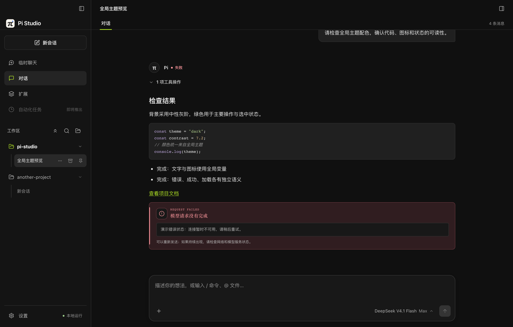
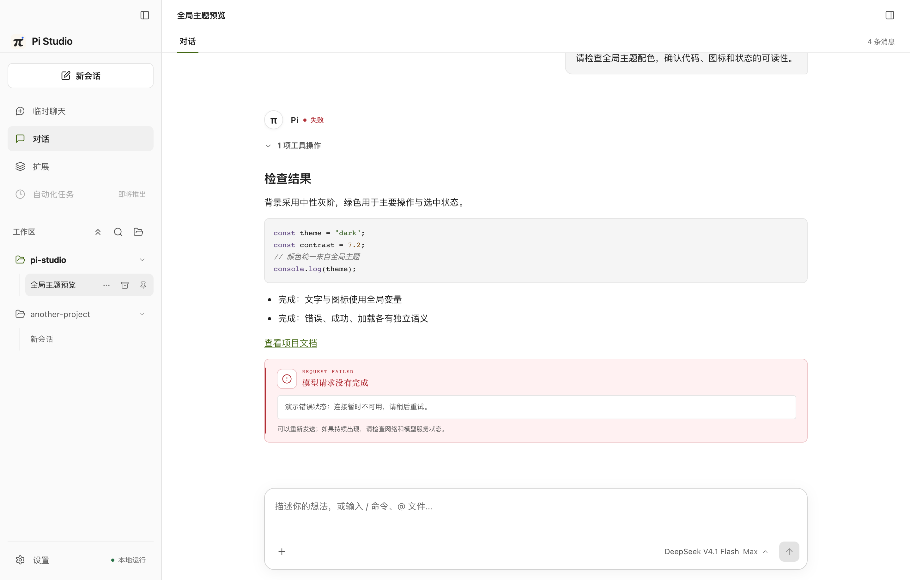
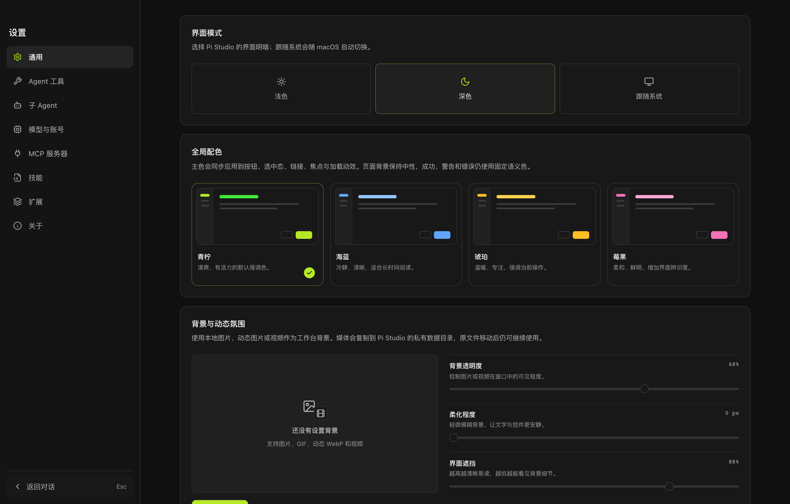
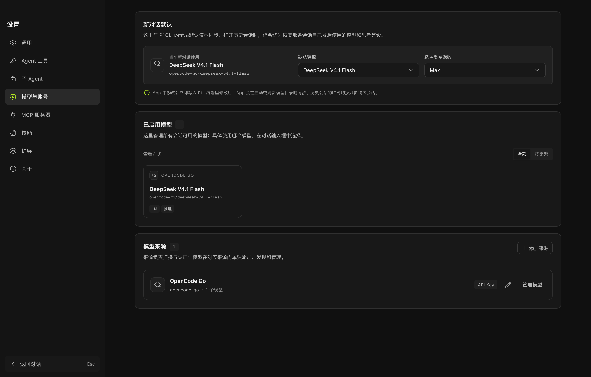

**Pi 编程助手的原生 macOS 桌面工作台。** 会话、密钥、模型、技能、扩展与 MCP，都与本地 `pi` CLI 共用同一份数据。

[](https://github.com/huangrx6/pi-studio/actions/workflows/ci.yml) [](https://github.com/huangrx6/pi-studio/releases/latest) [](LICENSE)

[下载 macOS 版](https://github.com/huangrx6/pi-studio/releases/latest) · [文档主页](https://huangrx6.github.io/pi-studio/) · [问题反馈](https://github.com/huangrx6/pi-studio/issues)

## 概览

Pi Studio 把 [Pi 编程智能体](https://github.com/earendil-works/pi) 搬进原生桌面窗口，而不是给 CLI 套一层终端。工作区、模型目录、技能、扩展与 MCP 都有对应的原生视图，改动直接写回 Pi 的配置文件。

> 会话留在本地，密钥留在本地，技能与扩展也留在本地。窗口只是让这些原本在终端里的东西，顺手一点。

- **内核即 Pi。** 会话以 Pi `SessionManager` 的 JSONL 为唯一事实来源，桌面端与 `pi` CLI 打开的是同一份历史，重启后完整恢复。
- **数据全在本地。** `~/.pi/agent` 下的 API Key、模型目录、MCP、技能与扩展由两端共同读写，不做任何云端同步。
- **不引入额外运行时。** DeepSeek Harness 只贡献视觉令牌与样式，没有 DSH Host、插件运行时、会话持久化或工作区注册表。

## 界面

| 深色主题 | 浅色主题 |
| :--: | :--: |
|  |  |
| 流式对话、工具调用与错误状态 | 同一会话的浅色主题 |

| 设置 | 模型目录 |
| :--: | :--: |
|  |  |
| 外观、字号、圆角与交互偏好 | 按提供方启用的模型子集 |

更多界面见[文档主页](https://huangrx6.github.io/pi-studio/)。

## 下载

到 [Releases](https://github.com/huangrx6/pi-studio/releases/latest) 选择对应架构的安装包：

| 平台 | 安装包 | 适用机型 |
| :-- | :-- | :-- |
| Apple Silicon | `Pi-Studio-<版本>-arm64.dmg` | M1 — M4 |
| Intel | `Pi-Studio-<版本>-x64.dmg` | Intel 芯片 Mac |

安装包由 GitHub Actions 在 macOS 上自动构建，当前**未签名、未公证**。首次打开若提示「无法验证开发者」，任选其一：

```bash
# 命令行移除隔离标记
xattr -cr "/Applications/Pi Studio.app"
```

或者右键点击应用 →「打开」→ 再点「打开」。

## 功能

### 会话与工作区

流式对话、思维链展开、工具轨迹；会话以 JSONL 保存，重启后完整恢复。可编辑的消息队列、pi-todo 计划面板、会话归档与分叉。技能与文件引用在输入框内联高亮，历史消息里以徽章展示。

多工作区切换，右栏文件树、可调宽文本预览与 Git 差异工作台；`@` 引用文件或目录，附件拖拽上传。另有不落盘的临时聊天页，可选工作区也可独立使用，支持文字、图片、流式回复与停止。

长会话默认加载最近 200 条消息，滚动到顶部附近时自动补载；右侧大纲始终覆盖完整会话并可跨分页跳转。

### 模型与提供方

模型选择器由本地 Pi 目录驱动；在设置里编辑 API Key，添加 OpenAI / Anthropic / Google 兼容提供方，配置模型发现请求、上下文窗口、最大输出、图片与推理能力。全局默认模型与 Pi CLI 共用，每个模型可保留自己的 thinking 强度；配置保存后会热加载到空闲会话，运行中的会话在本轮结束后切换。

### 技能、扩展、MCP 与子 Agent

技能与扩展统一展示来源；扩展支持 npm 与 git 包源的安装、卸载；MCP 支持 stdio 与 HTTP 服务器的添加、启停与编辑。集成 `pi-subagents` 后可以查看前台、后台和并行子 Agent，按角色覆盖模型与 thinking，并进入隔离的子会话上下文。

扩展 UI 遵循 Pi 原生 `ctx.ui` 契约：状态、widget、浮层、选择器与输入框都由桌面端通用渲染，同一份扩展代码可在 `pi` 终端与 Pi Studio 中运行。详见 [扩展 UI 契约](docs/extension-ui-contract.md)。

### 桌面体验

亮暗双主题、六套全局配色、可跟随系统、统一圆角与字号层级，以及图片、GIF、视频背景与透明度 / 模糊控制。窗口关闭后默认隐藏，可从菜单栏继续查看运行中的会话和完成通知；输入框左侧可切换工具权限模式（请求批准 / 帮我批准 / 完全权限，配合 pi-mode-switcher 扩展）。

应用会定期检查 GitHub Releases。发现新版本后会通过系统通知和左上角品牌旁的更新入口提醒；下载完成后可以立即重启安装，也可以留到下一次退出 Pi Studio 时自动安装。完整步骤见[应用更新](#应用更新)。

### 性能与内存

流式消息按动画帧合并，历史与子 Agent transcript 都有窗口上限；切换会话时释放空闲 Agent 运行时，会话详情缓存只保留少量小会话，文件预览缓存最多 8 个，工具目录运行时最多保留两个工作区。正在输出的回合不启用离屏内容优化，已完成长会话仍按可见区域渲染。

## 与 Pi 共用同一份数据

```text
~/.pi/agent/
├── sessions      # 会话 JSONL（唯一事实来源）
├── auth.json     # API Key
├── models.json   # 提供方与模型目录
├── mcp.json      # MCP 服务器
├── skills        # 技能
└── extensions    # 扩展
```

在「设置」中做的修改会写回上述文件，`pi` CLI 立即可见；反过来也一样。

## 本地开发

需要 Node.js ≥ 20 与 pnpm。

```bash
pnpm install
pnpm dev          # Vite + Electron 热更新
pnpm test         # 单元测试
```

生产模式运行：

```bash
pnpm run build
pnpm start
```

## 打包与发布

```bash
pnpm dist         # 产出 arm64 / x64 的 DMG、自动更新 ZIP 与 latest-mac.yml
```

发布由 [Release workflow](.github/workflows/release.yml) 完成：推送 `v*` 标签（或在 Actions 页手动触发）后，在 macOS runner 上构建并创建 GitHub Release。构建与测试检查见 [CI workflow](.github/workflows/ci.yml)。

## 应用更新

Pi Studio 使用 `electron-updater` 读取 GitHub 最新 Release。自动检查会在应用启动后延迟执行，并在前台使用期间按固定间隔和窗口重新聚焦时补充检查；GitHub 不会直接向桌面客户端推送 webhook，因此这种后台检查就是桌面端可用的推送方式。

| 文件 | 用途 |
| :-- | :-- |
| `Pi-Studio-<版本>-<架构>.dmg` | 首次安装与手动下载 |
| `Pi-Studio-<版本>-<架构>.zip` | macOS 自动更新 |
| `latest-mac.yml` | 版本、下载地址与校验信息 |
| `*.blockmap` | 差分下载加速 |

Release workflow 会将以上文件全部上传。应用使用 `autoDownload = false`：检测到版本后只提示，不会擅自占用带宽；下载完成后由用户选择立即重启或下次退出安装。

macOS 的原地自动安装要求应用使用 Developer ID 签名并通过 Apple 公证。仓库的 Release workflow 已支持通过以下 Actions secrets 注入证书和公证凭据：

- `CSC_LINK`
- `CSC_KEY_PASSWORD`
- `APPLE_ID`
- `APPLE_APP_SPECIFIC_PASSWORD`
- `APPLE_TEAM_ID`

未配置这些 secrets 时仍可检查与下载更新，但系统可能拒绝自动覆盖安装。发布页中的第一次手动安装仍需按上文处理 Gatekeeper 提示。

## 仓库结构

```text
pi-studio/
├── electron/            # 主进程
│   ├── core/            # 共享状态、消息序列化、附件标记
│   ├── services/        # 会话、模型、设置、文件、附件、macOS 应用
│   ├── ipc/             # 按域注册的 IPC 处理器
│   ├── main.cjs         # 入口：生命周期与装配
│   └── window.cjs       # 窗口、菜单、主题
├── web/                 # 渲染进程（React + Vite）
│   └── src/
│       ├── components/
│       └── styles/      # 设计令牌与调色板
├── scripts/             # 启动器、图标构建、QA 脚本与单元测试
├── assets/              # 应用图标与 README 横幅
├── docs/                # 文档主页（GitHub Pages）
└── screenshots/         # README / 文档用截图
```

主进程按「共享状态 → 服务 → IPC」分层：`core/state.cjs` 持有窗口、模型与运行时单例，`services/` 只关心各自领域，`ipc/` 负责参数校验与通道注册，`main.cjs` 只做装配。

## 尚未完成

- OAuth 登录界面（当前在设置中编辑 API Key）
- 插件 / 自动化页面与 Trace 视图
- 技能与扩展的单独启停
- 文件预览的行号与 Shiki 高亮
- 在 repository secrets 中配置 Developer ID 签名与 Apple 公证凭据
- Windows / Linux 支持

## 许可

代码以 [MIT](LICENSE) 许可发布。部分视觉样式复制自 DeepSeek Harness（MIT），详见 [THIRD_PARTY_NOTICES.md](THIRD_PARTY_NOTICES.md)。
