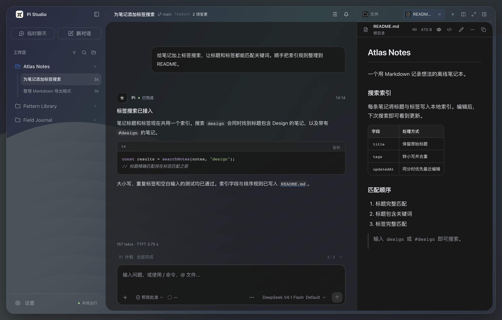

# Pi Studio

Pi Studio 是一款基于 Pi Durable 的 macOS 桌面应用，适合与 AI 一起维护代码库的人。打开项目文件夹，就能让智能体阅读代码、修改文件、运行测试。你可以在同一窗口查看它用过哪些工具、改过哪些行，并打开文件核对结果。

[下载 macOS 版](https://github.com/huangrx6/pi-studio/releases/latest) · [产品主页](https://huangrx6.github.io/pi-studio/) · [使用手册](https://huangrx6.github.io/pi-studio/guide.html) · [反馈问题](https://github.com/huangrx6/pi-studio/issues)



*在演示项目 Atlas Notes 中，智能体为笔记加上标签搜索。右侧的 README 列出了这次实现采用的索引规则。*

## 开始第一次对话

1. **安装应用。** 在上方下载页的 Assets 中，Apple 芯片的 Mac 选文件名以 `arm64.dmg` 结尾的安装包，Intel Mac 选 `x64.dmg`。打开磁盘映像，把 Pi Studio 拖入「应用程序」。安装包使用项目自签名证书，尚未经过 Apple 公证。若首次打开提示无法验证开发者，确认来源后，可在「系统设置 → 隐私与安全性」选择「仍要打开」。[Apple 说明](https://support.apple.com/zh-cn/102445)
2. **接入模型。** 在「设置 → 模型配置」中添加模型来源，按服务商要求填写接口地址和凭据，启用至少一个模型。支持 OpenAI Completions、OpenAI Responses、Anthropic Messages 和 Google Generative AI 协议。
3. **选择工作区。** 点击「新对话」，在输入框里选一个项目文件夹和工具权限模式。可以先问「这个项目从哪里启动？请给出入口文件和测试命令」，再用 `@` 引用具体文件继续追问。

## 在项目里工作

| 想做的事 | 在 Pi Studio 中怎么做 |
| --- | --- |
| 跟进一轮修改 | 展开回复里的「执行轨迹」看工具调用，在本轮文件变更中核对差异。运行中可补充要求，或用 `⌘ Enter` 将下一条消息排队。 |
| 亲自验证结果 | 展开右侧工作台，预览工作区文件、打开终端运行测试，或在浏览器标签里检查本地页面。「运行服务」可以查看工作区的服务进程。 |
| 拆分较长的任务 | 用 `/goal <目标>` 设置目标，让同一会话分轮推进。将独立的工作交给子智能体后，可以在子智能体视图查看各自的任务与进度。 |
| 比较两个模型 | 在工作台选择「模型双跑」，让两个模型回答同一个问题，分别查看输出和性能。 |
| 临时问个问题 | 从侧栏打开「临时聊天」。这段对话保存在内存中，关闭后不会进入工作区会话历史。 |

[查看会话与计划截图](docs/assets/screens/conversation-dark.png) · [查看子智能体截图](docs/assets/screens/subagents-light.png)

## 数据、权限与扩展

Pi Studio 管理自己的本地数据目录 `~/.pi-studio/`，其中保存会话、工作区索引与设置。模型凭据由 Electron 的 `safeStorage` 加密保存。权限策略可以按用户、工作区或会话设置。[资源作用域与生效规则](docs/resources.md)

可以把团队惯例写进项目的 `AGENTS.md`，把重复工作整理成技能，或通过 MCP 接入现有工具。需要提供自定义工具或界面时，可以从示例扩展起步。含可执行代码的扩展以受信任的 Node.js 模块在 Electron 主进程运行，界面由声明式数据描述。[技能管理](docs/skill-hub.md) · [示例扩展](examples/extensions/agent-starter) · [扩展开发](docs/extensions.md) · [扩展分发](docs/extensions-distribution.md)

## 从源码运行

使用 Node.js 22.19.0 或更高版本，以及项目在 [package.json](package.json) 中指定的 pnpm 版本。在仓库根目录执行以下命令即可启动桌面开发版。

```sh
pnpm install --frozen-lockfile
pnpm dev
```

提交改动前，运行项目的完整检查。

```sh
pnpm run extension:schema
pnpm test
pnpm run build
git diff --check
```

代码按工作区、工具权限、模型和扩展等功能组织。新增能力时可参照[能力模块说明](docs/architecture/capabilities.md)。本项目采用 [MIT 许可证](LICENSE)，第三方组件的许可见[第三方声明](THIRD_PARTY_NOTICES.md)。
