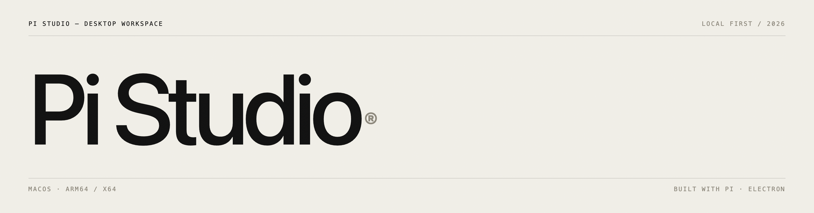
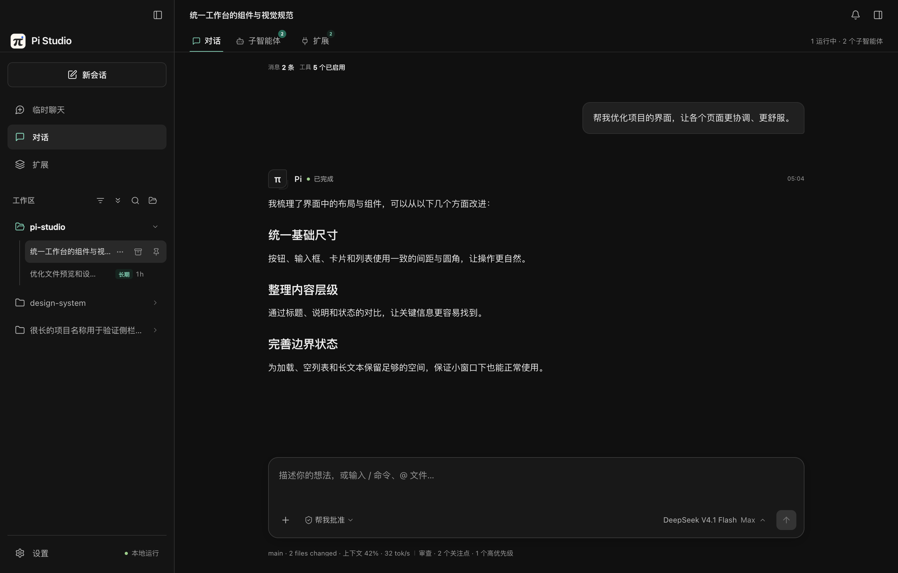
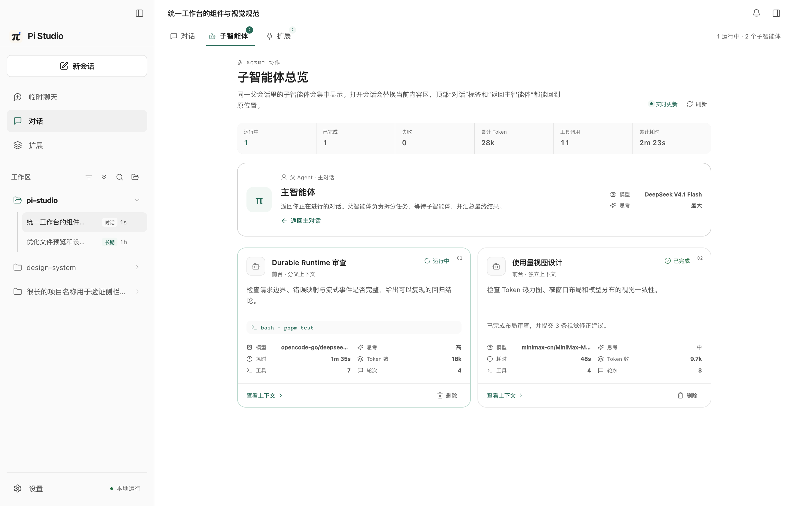
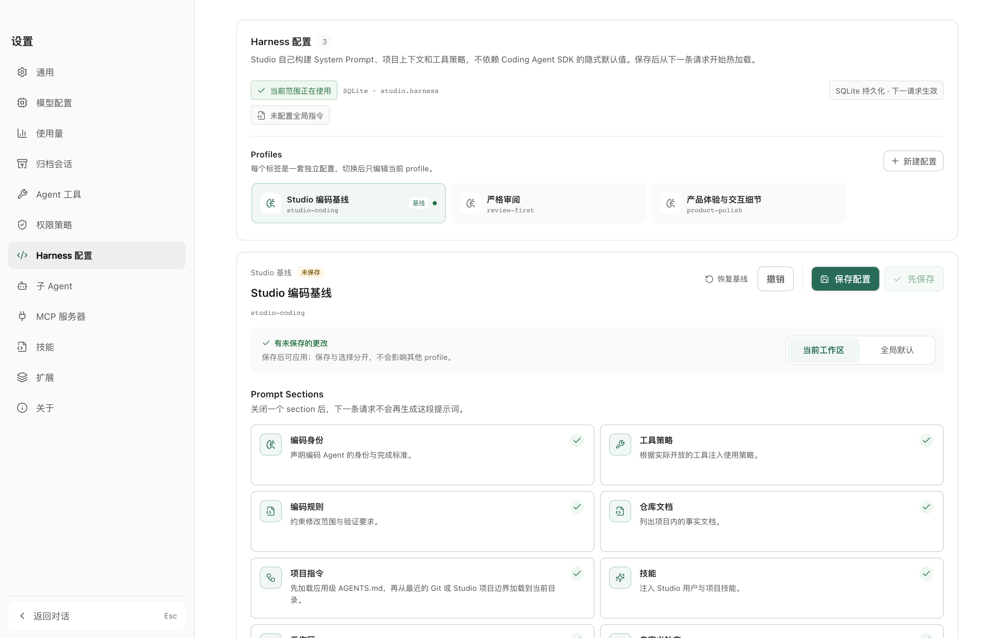
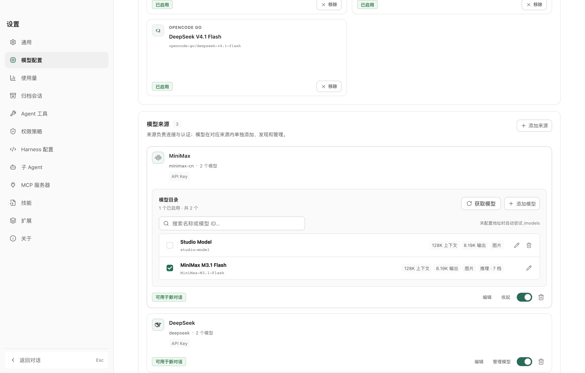

**基于 Pi Durable 的原生 macOS 桌面 Agent 工作台。** 会话、模型、凭据、MCP、技能与扩展由 Pi Studio 独立管理；应用不读取，也不修改 Pi CLI 自己的配置。

[](https://github.com/huangrx6/pi-studio/actions/workflows/ci.yml) [](https://github.com/huangrx6/pi-studio/releases/latest) [](LICENSE)

[下载 macOS 版](https://github.com/huangrx6/pi-studio/releases/latest) · [产品主页](https://huangrx6.github.io/pi-studio/) · [完整手册](https://huangrx6.github.io/pi-studio/guide.html) · [资源作用域](docs/resources.md) · [问题反馈](https://github.com/huangrx6/pi-studio/issues)

## 概览

Pi Studio 把 Pi Durable 的持久化 Agent 能力带进桌面窗口。每个普通对话、长期任务和子智能体都由同一个 Durable Harness 执行；Studio 负责工作区、模型目录、编码提示、工具权限、附件和原生交互。

- **唯一执行引擎是 Pi Durable 1.4。** 对话、任务、流式事件、分叉、恢复和 owned child conversations 都走 Durable Runtime。
- **Studio 拥有自己的数据。** 应用使用 `pi-studio.sqlite` 保存 Durable 的 `durable_*` 表，以及 Studio 的工作区、会话投影、模型、凭据、MCP、扩展和设置记录。
- **临时聊天不落盘。** 临时会话复用 Durable 执行能力，但使用独立的 `MemoryStorage`，退出后不会留下对话、附件或工作区记录。
- **编码 Harness 可检查、可配置。** Studio 默认启用完整编码基线，并把八个 Prompt 部分、实际工具说明、项目指令和自定义补充组成可管理的 profile。

## 界面

| 深色会话 | 子智能体 |
| :--: | :--: |
|  |  |
| 流式对话、工具调用与扩展入口 | 子智能体状态与独立上下文 |

| Harness 配置 | 模型配置 |
| :--: | :--: |
|  |  |
| Prompt、AGENTS.md、Skill 与工具 guidance | 来源、模型发现、能力与 thinking |

更多界面、完整使用说明、扩展开发接口和架构说明见[文档中心](https://huangrx6.github.io/pi-studio/guide.html)。

## 下载

到 [Releases](https://github.com/huangrx6/pi-studio/releases/latest) 选择对应架构的安装包：

| 平台 | 安装包 | 适用机型 |
| :-- | :-- | :-- |
| Apple Silicon | `Pi-Studio-<版本>-arm64.dmg` | M1 — M4 |
| Intel | `Pi-Studio-<版本>-x64.dmg` | Intel 芯片 Mac |

安装包由 GitHub Actions 在 macOS 上使用固定的自签名证书构建。该证书让后续 Release 保持同一更新身份，但不等同于 Apple Developer ID 或公证，首次打开仍可能提示「无法验证开发者」：

```bash
xattr -cr "/Applications/Pi Studio.app"
```

也可以右键点击应用 →「打开」→ 再点「打开」。

## 功能

### Durable 会话与工作区

普通对话和长期任务共用同一条 Durable 会话链路。Studio 在 SQLite 中保存标题、工作区、置顶、归档和长期任务侧边栏投影；目标正文、完成条件与执行状态保存在 Durable document 中。长期任务通过原生 `GenerationTask.onYield` 继续执行，直到目标完成、阻塞、用户暂停，或触发可配置的单次轮次/连续无进展安全阀。安全暂停会保留原因并等待用户确认后继续。Durable 同时保存 transcript、task、usage 与 live state，流式输出、thinking、工具调用、中断和分叉都由 Durable 事件驱动。

会话历史按页加载，右侧大纲始终基于完整会话；向上滚动接近顶部时才继续补载。多工作区切换、文件树、可调宽预览、按回合汇总的 Git 差异、`@` 文件引用和附件上传都在同一桌面界面中完成。

临时聊天使用独立的内存 Durable Runtime，可选工作区并支持文字、图片、流式回复和停止。关闭或退出后不会写入 Studio SQLite、工作区附件目录或会话历史。

### Studio 模型与凭据

模型来源、模型清单、能力字段、启停状态和 API Key 都由 Studio SQLite 管理。设置页支持 OpenAI Completions、OpenAI Responses、Anthropic Messages 与 Google Generative AI 协议，并可调用来源提供的模型发现接口。

新对话默认模型和模型级 thinking 强度保存在 Studio 内。当前会话可以随时切换模型与 thinking；正在运行的请求不会被改写，新配置从下一次请求开始生效。

### 可配置编码 Harness

Pi Durable 提供可组合的 Agent Runtime，Studio 负责构建面向编码任务的系统提示。默认 `Studio 编码基线` profile 包含八个可独立开关的部分：

1. `preamble`：编码 Agent 身份、证据优先和完成标准。
2. `tools`：按本次实际开放的工具生成用途与调用策略。
3. `rules`：读取、最小修改、验证、安全与诚实报告规则。
4. `repositoryDocs`：列出可读取的仓库文档。
5. `projectContext`：先注入应用级 `<Studio userData>/AGENTS.md`，再从最近的 Git 或 Studio 项目边界到当前目录，按 `AGENTS.md`、`.pi-studio/AGENTS.md` 的顺序注入项目指令。
6. `skills`：注入 Studio 用户级与项目级 `SKILL.md`。
7. `cwd`：声明当前主工作区。
8. `addendum`：当前 profile 的自定义补充指令。

profile 支持全局选择和按工作区覆盖，也可以为单个工具增加 guidance。设置保存后会重建 registry；空闲会话直接采用新配置，忙碌会话等待下一请求边界。

Durable 运行策略独立保存在 Studio SQLite，并覆盖请求超时、自动重试、上下文压缩、工具并行、失败后排队输入、崩溃恢复和内存缓存。默认采用 `parallel`：模型在同一轮发出的独立读取、搜索、读取工具或子智能体调用会同时执行；依赖前一步结果的调用仍留到下一轮，避免用并发破坏正确性。策略由 getter 在每次执行边界读取，修改后不需要重启应用。

多步骤工作由内置 `todo` 工具维护会话级计划。计划状态保存为 Durable conversation document，UI 从最新工具结果读取快照并显示在输入框上方；切换会话、重启应用或上下文压缩后仍可继续。任务支持依赖、进行中、完成、结束、归档与恢复，模型默认在多步任务开始前用一次 `createMany` 建立计划。

Studio 不声称与 Pi Coding Agent SDK 逐字节一致。默认 Harness 明确提供编码身份、执行规则、项目 `AGENTS.md`、Skill、工具说明和工作区上下文；实际工具 schema 与执行行为由扩展提供，用户可通过 profile 覆盖 Prompt section 和工具 guidance，也可安装 Agent 扩展注册新工具。相同模型在不同 Harness 下仍可能产生不同结果，因此质量和兼容性应以真实编码任务及测试结果判断。

### 扩展、MCP 与技能

Studio 扩展分为两种能力：

- **Agent 扩展**是受信任的主进程 Node 模块，通过 Durable 提供 tools、sections、hooks 和 tasks。
- **UI 扩展**只提交 JSON 安全的声明式内容，Studio 用统一组件和全局设计令牌渲染；renderer 不接收 HTML、CSS、JS、React 或任意 IPC。

扩展分为 builtin、user 和 project scope。内置扩展默认信任；用户扩展导入后默认信任；项目扩展默认不信任，必须在设置页确认。贡献使用稳定 ID；未知 slot、权限、action 或非法内容会让对应 manifest 校验失败并报告精确路径，其他已加载扩展不受影响。

扩展发行支持本地目录、确定性 `.pi-extension.zip`、固定 HTTPS 摘要、GitHub Release 和静态 registry。安装先进入隔离区，再校验 manifest、Pi Studio 版本范围、权限、ZIP 路径、包内符号链接及逐文件 SHA-256；可选 Ed25519 签名会把扩展 ID、版本、发布者和内容树绑定到发布者公钥。未知公钥必须在预览中确认指纹，受信任公钥自动校验，撤销后禁止继续安装。升级保留旧版本用于回滚，并把代码、安装状态和扩展数据分目录保存。扩展作者可从 `node tools/cli/pi-studio-extension.mjs keygen|sign|validate|pack|publish` 开始；格式、CLI 与 registry 规则见[扩展规范](docs/extensions.md)、[声明式 UI 规范](docs/extension-ui.md)、[扩展发行规范](docs/extensions-distribution.md)和[内置能力审查](docs/extensions-audit.md)。JSON Schema 由 `pnpm run extension:schema` 生成。

仓库顶层 `extensions/` 保存随应用分发的 first-party 扩展。当前包含 `pi-quota-status`：它按当前模型来源，通过固定 HTTPS 接口和受控的 `provider.credentials` capability 读取当前来源密钥，展示 OpenCode Go、GLM Coding Plan、MiniMax Token Plan、Kimi、DeepSeek、SiliconFlow 与 OpenRouter 的套餐窗口或账户余额。密钥不进入 renderer，也不会写入扩展数据。

所有跨资源的 scope、冲突优先级、存储、信任边界和刷新时机统一见[资源作用域、优先级与刷新](docs/resources.md)。工作区资源按精确 `cwd` 匹配；只有项目 `AGENTS.md` 会从最近的 `.git` / `.pi-studio` 边界逐级加载。

模型、凭据、MCP、技能和扩展状态都不会回写 Pi CLI 配置，也不会读取 `~/.pi`。MCP 支持 stdio 与 HTTP，配置保存在 Studio SQLite；Studio 导入的 Skill 正文保存在应用用户目录或当前项目的 `.pi-studio/skills`，SQLite 只额外保存项目信任指纹。

Skill 遵循 Agent Skills 的按需加载方式：递归发现 `SKILL.md`，系统提示只包含 `name`、`description` 和绝对路径；模型通过本次开放的 `read` 或 `bash` 工具读取正文。Studio 同时读取通用 `<home>/.agents/skills` 与 `<workspace>/.agents/skills`，项目技能优先于用户技能。`disable-model-invocation: true` 的技能只允许通过 `/skill:<name>` 显式调用。项目 Skill 先验证完整目录，再要求用户信任；隐藏文件也参与指纹，内容或链接变化会立即让旧信任失效。元数据缓存避免在每个模型循环轮次重复读取大型附件。

MCP 默认使用 `deferred` 和 Durable 官方 `tool_search`。模型先搜索工具元数据，命中的工具从下一次模型请求开始可用；已加载选择会保存在该会话分支中。MCP 发出 `tools/list_changed` 后，Studio 会刷新该 server 的 registry；配置改变时旧连接会进入退休态，等已经开始的工具调用结束后再关闭。远程 HTTP MCP 必须使用 HTTPS，只有本机回环地址允许明文 HTTP；stdio 子进程只继承 `PATH`、`HOME` 等运行所需环境，其他密钥必须通过 `${NAME}` 显式传入。

当前 Studio 没有 codemode，因此 `deferred` 是 MCP 的合理默认，同时保留 `direct` 和 `hidden` 覆盖。HTTP 认证使用配置的 headers；MCP OAuth 登录、资源列表/读取工具、prompts、sampling 和 tasks 尚未接入。环境变量支持 `${NAME}` 引用，但不执行配置中的 `!command`。完整的应用级 scope、存储与热加载语义见[资源作用域](docs/resources.md#9-mcp)。

### 子智能体

Studio 的 `subagent` 工具通过 Durable 创建 owned child conversation。子智能体拥有独立上下文、模型、thinking 强度和可用工具；父会话以工具任务为归属读取子会话，不额外创建 Studio 会话投影。支持前台执行、后台并行、`bg_wait`、`subagent_stop`、子智能体发起 `contact_supervisor` 和父智能体使用 `subagent_supervisor` 回复。

界面提供子智能体总览、运行状态、只读 transcript、独立上下文页面和返回主智能体的路径。长 transcript 继续使用分页，避免打开子智能体时一次性加载全部历史。

### 桌面体验

亮暗外观、四套全局强调色、四个圆角尺度、对话字号和可跟随系统的主题都由统一设计令牌控制。背景支持静态图片、GIF、动态 WebP 与视频，并提供透明度、柔化和界面遮挡控制。

关闭窗口后应用可继续驻留菜单栏，展示正在运行的会话；一轮结束后可弹出结果卡片并跳回对应会话。输入框左侧提供请求批准、帮我批准和完全权限三种工具策略。

应用会检查 GitHub Releases。发现新版本后会在品牌入口、系统通知和菜单栏提示；下载完成后由用户选择立即重启，或留到下一次退出时安装。

### 性能

流式文本按帧合并，历史和子智能体 transcript 都有窗口上限；完成的思考与工具步骤支持折叠。对话详情、文件预览、工具目录和子智能体数据都有独立缓存边界，长时间使用时不会无限累积浏览器侧状态。

## 数据边界

```text
Pi Studio userData/
├── AGENTS.md            # 应用级 Harness 指令
├── pi-studio.sqlite
│   ├── durable_*        # Durable 会话、任务、文档、用量与实时状态
│   ├── conversations    # Studio 的侧边栏与长期任务投影
│   ├── settings         # 外观、Harness、工具与子智能体配置
│   ├── model_*          # Studio 模型来源与目录
│   ├── credentials      # Studio API Key
│   ├── mcp_servers      # Studio MCP 配置
│   ├── project_resource_trust # 项目 Skill 信任指纹
│   ├── studio_extensions
│   └── workspaces / turn_diffs
├── skills/              # 用户级 SKILL.md
├── extensions/          # 用户级 Studio 扩展
├── extension-state/     # 受管安装、活动版本与回滚状态
├── extension-data/      # 跨版本保留的扩展运行数据
├── extension-cache/     # 导入 quarantine 等缓存
└── extension-publishers.json # 本机信任的 Ed25519 发布者公钥

<home>/.agents/skills/   # 跨客户端通用用户技能

<workspace>/
├── AGENTS.md            # 项目 Harness 指令
├── .agents/skills/      # 跨客户端通用项目技能
└── .pi-studio/
    ├── AGENTS.md        # 项目 Harness 指令
    ├── skills/          # 项目级 SKILL.md
    └── extensions/      # 项目级 Studio 扩展
```

Durable 与 Studio 使用同一个 SQLite 文件中的不同表，并以 WAL、`busy_timeout` 和独立连接协调。临时聊天不进入这棵树。

## 架构

```text
React renderer
    │  typed window.piApi contract
    ▼
Electron preload / IPC
    ├── Durable conversations, tasks and events
    ├── Studio SQLite projections and settings
    ├── Harness profiles and built-in extensions
    ├── MCP, Skills and Studio extensions
    └── Files, attachments, updater and menu bar
            │
            ▼
Pi Durable 1.4 Harness
```

`electron/services/durable-runtime.cjs` 是唯一共享运行时装配点。`electron/ipc/sessions.cjs` 把 Durable 的提交、分页、分叉、状态、模型和 thinking 映射成 renderer DTO；扩展与 MCP 在下一个请求边界热刷新。

## 本地开发

需要 Node.js ≥ 22.19 与 pnpm：

```bash
pnpm install
pnpm dev          # Vite + Electron 热更新
pnpm test         # Node 契约、状态、Harness、扩展与任务测试
pnpm build        # TypeScript 检查 + Vite 生产构建
pnpm qa:memory    # 长会话、图片、子智能体、反复切换与退出回收
pnpm extension -- validate examples/extensions/agent-starter
pnpm extension -- pack examples/extensions/agent-starter --out release
```

测试覆盖会话分页与标题、Durable task、Harness profile 与项目指令、扩展 manifest/信任/路径边界、子智能体设置、文件差异、更新状态和 Electron import 完整性。视觉与真实窗口交互由 `tools/qa/qa-*.mjs` 单独运行，不与 `pnpm test` 混为一组。

## 打包与发布

```bash
pnpm release:dist # 使用稳定自签名身份构建并验证 arm64 / x64 安装与更新包
```

发布由 [Release workflow](.github/workflows/release.yml) 完成。推送 `v*` 标签或在 Actions 页手动触发后，macOS runner 会构建并创建 GitHub Release；CI 检查见 [CI workflow](.github/workflows/ci.yml)。

正式 macOS 包必须使用稳定签名身份。首次发布或证书轮换时运行：

```bash
pnpm release:cert
```

将 `.release-signing/pi-studio-self-signed.p12` 的 Base64 内容保存为仓库 secret `CSC_LINK`，将密码文件内容保存为 `CSC_KEY_PASSWORD`。后续发布必须复用同一份证书；重新生成证书会改变更新身份，使旧客户端无法通过 Squirrel.Mac 自动覆盖安装。证书私钥不得提交到仓库。

## 应用更新

Pi Studio 使用 `electron-updater` 读取 GitHub 最新 Release。GitHub 不会向桌面客户端主动推送 webhook，因此应用在启动后延迟检查，并在前台使用和窗口重新聚焦时补充检查。

| 文件 | 用途 |
| :-- | :-- |
| `Pi-Studio-<版本>-<架构>.dmg` | 首次安装与手动下载 |
| `Pi-Studio-<版本>-<架构>.zip` | macOS 自动更新 |
| `latest-mac.yml` | 版本、下载地址与校验信息 |
| `*.blockmap` | 差分下载加速 |

应用不会自动下载更新。macOS runner 会用稳定的自签名身份完整签署 `.app`，并在发布前验证 `.app` 与自动更新 ZIP 内的签名。只要后续 Release 复用同一证书，即可保持 Squirrel.Mac 的原地更新身份连续性。

自签名证书只解决更新身份连续性，不提供 Apple 信任链或公证。由于历史版本包含无效的 ad-hoc 签名，首次迁移到重新发布的 `v0.0.5` 需要手动下载并覆盖安装一次；从该版本开始，后续更新可以正常走应用内安装。

## 仓库结构

```text
pi-studio/
├── electron/
│   ├── core/            # Studio SQLite、设置与序列化
│   ├── services/        # Durable runtime、模型、扩展、MCP、文件与桌面能力
│   ├── ipc/             # 按领域注册的 IPC
│   ├── main.cjs         # 生命周期与模块装配
│   └── window.cjs       # 窗口、菜单、主题
├── web/                 # React + Vite renderer
│   └── src/
│       ├── components/
│       └── styles/      # 全局 token 与调色板
├── docs/                # GitHub Pages、资源作用域与扩展规范
├── tests/
│   ├── electron/        # 主进程、存储、扩展与运行时测试
│   ├── web/             # 渲染层纯函数与交互状态测试
│   └── integration/     # Durable、扩展分发与 CLI 集成测试
├── tools/
│   ├── cli/             # 扩展作者与维护 CLI
│   ├── icons/           # 应用、菜单栏图标生成
│   └── qa/              # 桌面截图、流式稳定与真实 Electron 内存检查
├── extensions/          # 随应用分发的官方扩展
├── assets/              # 图标与 README 横幅
└── docs/assets/screens/ # README / 文档精选截图
```

## 尚未完成

- 模型提供方与 MCP 的 OAuth 登录界面（当前模型使用 API Key，HTTP MCP 使用 headers）。
- MCP resources/templates、prompts、sampling 与 tasks 的专用界面。
- 插件市场与自动发现。
- Windows / Linux 支持。
- Apple Developer ID 签名与公证；当前稳定自签名只保证 Pi Studio 自身更新身份连续。

## 许可

代码以 [MIT](LICENSE) 许可发布。部分视觉样式参考 DeepSeek Harness（MIT），详见 [THIRD_PARTY_NOTICES.md](THIRD_PARTY_NOTICES.md)。
